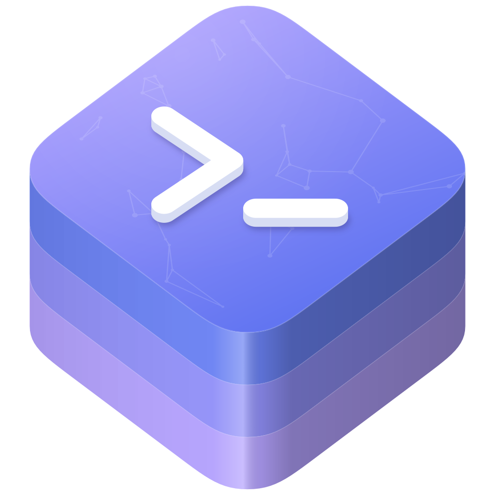

<div align="center">

<p align="center">
  <a href="https://github.com/swift-library/swift-codex"></a>
</p>

<h1 align="center">swift-codex</h1>

<p align="center">
  Drive the Codex CLI from Swift through separate exec, App Server, and MCP interfaces.
</p>

<p align="center">
  <a href="https://github.com/swift-library/swift-codex/actions/workflows/swift-package.yml"></a>
  
  
  <a href="LICENSE.txt"></a>
</p>

<p align="center">
  <a href="#overview">Overview</a> ·
  <a href="#quick-look">Quick look</a> ·
  <a href="#install">Install</a> ·
  <a href="#usage">Usage</a> ·
  <a href="#requirements">Requirements</a> ·
  <a href="#documentation">Documentation</a> ·
  <a href="#contributing">Contributing</a> ·
  <a href="#license">License</a>
</p>

</div>

## Overview

Keep agent sessions inside a Swift app or server: run a turn, stream events, and resume a thread. Import the product for the machine interface you use; the [integration guide](Documentation/Usage/Integration.md) covers product selection, transports, approvals, and execution limits.

## Quick look

Install the Codex CLI and sign in with it before running a turn.

```swift
import Codex

func summarizeRepository() async throws {
  let codex = Codex()
  let thread = codex.startThread()
  let turn = try await thread.run(.text("Summarize this repository."))

  print(turn.finalResponse)
}
```

## Install

Add the package and the products you use to `Package.swift`:

```swift
dependencies: [
  .package(
    url: "https://github.com/swift-library/swift-codex.git",
    .upToNextMinor(from: "0.5.1")
  ),
],
targets: [
  .target(
    name: "YourTarget",
    dependencies: [
      .product(name: "Codex", package: "swift-codex"),
    ]
  ),
]
```

Depend on the narrowest product for your integration: `CodexExec` for direct
process control, `CodexMCP` for the MCP server, or `CodexAppServerClient` with
one transport, such as `CodexAppServerStdio`, for the App Server. The
[products guide](Documentation/Usage/Integration.md#products) table lists all eleven.

`CodexAppServerProtocol` and `CodexAppServerClient` generate their Swift models
from the vendored protocol schema with a SwiftPM build tool plugin during a
normal build. The generated code is not checked into the repository.

> [!NOTE]
> swift-codex is pre-1.0. Minor releases may include source-breaking
> changes, so depend on it with `.upToNextMinor(from:)`.

## Usage

Use `Codex` for thread and turn conveniences or select a lower-level product for process, JSON-RPC, or MCP control. The [integration guide](Documentation/Usage/Integration.md) covers streaming, thread resume, structured output, App Server transports, and MCP requests.

## Requirements

- Swift 6.2 or later
- macOS 14 or later
- The OpenAI Codex CLI, on `PATH` or set as an explicit executable, signed in
  or configured for the features you call

CI also builds `Codex`, `CodexExec`, `CodexMCP`, `CodexAppServerRuntime`,
`CodexAppServerProtocol`, `CodexAppServerClient`, `CodexAppServerStdio`, and
`CodexAppServerURLSession` on Windows x86_64 with Swift 6.2.3. `CodexAppServerNIO`,
`CodexAppServerVapor`, and `CodexAppServerHummingbird` are unavailable on
Windows because of their dependencies.
[Platform support](Documentation/Architecture/CodexTargetTopology.md#platform-support)
describes each product's Windows boundary.

swift-codex does not distribute the Codex CLI or credentials. Your app supplies
the executable, authentication, and launch configuration.

## Documentation

- [Usage guide](Documentation/Usage/Integration.md): examples, behavior, and limits.
- [Documentation index](Documentation/README.md): how the guides, architecture
  notes, and reference material are organized.
- Usage guides for [Codex](Documentation/Usage/Codex/README.md),
  [CodexExec](Documentation/Usage/CodexExec/README.md),
  [the App Server products](Documentation/Usage/CodexAppServer/README.md), and
  [CodexMCP](Documentation/Usage/CodexMCP/README.md).
- [Architecture](Documentation/Architecture/README.md): product boundaries,
  dependency direction, and platform support.
- [Reference](Documentation/Reference/README.md): the pinned protocol contract
  and method adoption inventory, plus release guidance.
- [Changelog](CHANGELOG.md)

Each public library also has a DocC catalog under
`Sources/<Target>/Documentation.docc`.

## Contributing

Read [CONTRIBUTING.md](CONTRIBUTING.md) before opening a pull request, and run
its local build, test, release build, formatting and package-specific checks
before submitting changes.
[Support](https://github.com/swift-library/.github/blob/master/SUPPORT.md) covers questions and bug reports. Report
vulnerabilities through the private route in [SECURITY.md](SECURITY.md).
Participation follows the [Code of Conduct](https://github.com/swift-library/.github/blob/master/CODE_OF_CONDUCT.md).

## License

swift-codex is licensed under the Apache License 2.0 with the Swift Runtime
Library Exception. See [LICENSE.txt](LICENSE.txt) and [NOTICE](NOTICE).

The vendored App Server protocol schema in `Vendor/CodexAppServerProtocolSchema`
is derived from the OpenAI Codex CLI source and is licensed under the Apache
License 2.0. See [THIRD_PARTY_NOTICES.md](THIRD_PARTY_NOTICES.md) and the
license and notice files in that directory.
